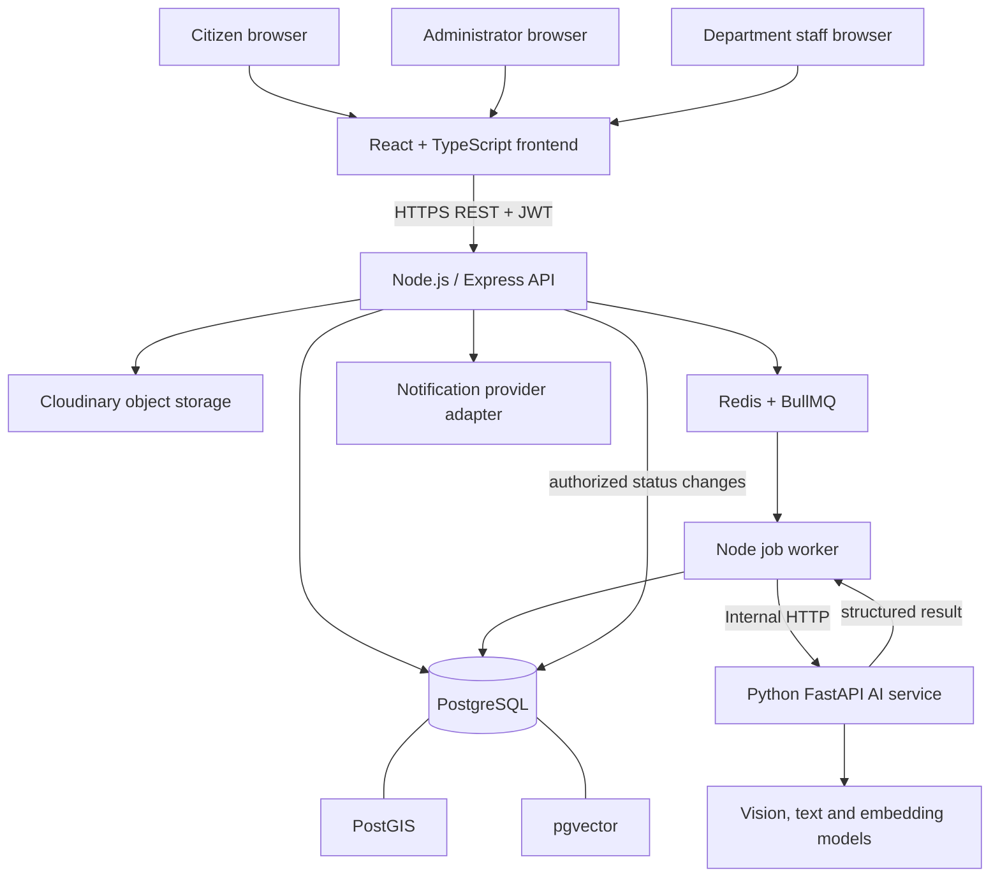

# CivicFix — System Architecture

## 1. Purpose and scope

CivicFix is an AI-assisted civic issue management platform. Citizens report local infrastructure and sanitation issues; AI services analyze reports and recommend classification, severity, possible duplicates, and department routing; authorized humans review recommendations and manage resolution.

**Trust boundary:** CivicFix initially manages reports internally. It must never claim that a complaint has been filed with, acknowledged by, or assigned to a government authority unless a real, verified integration is introduced later.

This document defines the logical architecture. It does not implement application code.

## 2. Architecture decisions

| Concern | Decision | Reason |
|---|---|---|
| Web application | React + TypeScript + Vite | Component-based, typed SPA and fast development |
| UI styling | Tailwind CSS with project design tokens | Implements the supplied Poster Modernist system consistently |
| Client routing | React Router | Role-aware citizen, administrator, and staff areas |
| Maps | Leaflet | Open-source map rendering and marker workflows |
| API backend | Node.js + Express REST API | Central business rules, authentication, authorization, and integrations |
| AI service | Python + FastAPI | Python model ecosystem and isolated inference dependencies |
| Agent orchestration | LangGraph in the AI service | Shared workflow state, conditional edges, retries, and human-review boundary |
| Primary data | PostgreSQL | Normalized relational records and transactions |
| Geospatial | PostGIS extension | Indexed point/radius and locality queries |
| Semantic search | pgvector extension | Stores and queries complaint embeddings |
| Background jobs | Redis + BullMQ in Node backend | Durable asynchronous work and retries |
| Image storage | Cloudinary initially, behind a storage adapter | Keeps large binary media out of relational tables |
| Deployment | Docker Compose for local development | Reproducible multi-service environment |

Use one modular backend and one AI service initially. Do not split every agent into its own deployable service. Do not add Kubernetes, Kafka, or a separate API gateway at this stage.

## 3. Logical architecture



The frontend never connects directly to PostgreSQL, Redis, Cloudinary administration APIs, or model runtimes. All privileged operations pass through the backend.

## 4. Service boundaries

### 4.1 Frontend — `frontend/`

Responsibilities:
- Public landing and product navigation.
- Citizen registration, login, complaint submission, complaint history, and status timeline.
- Administrator complaint queue, AI recommendation review, assignment controls, analytics, and map.
- Department staff queue, progress notes, evidence uploads, and resolution actions.
- Client-side form validation and accessible loading, empty, and error states.
- Rendering the Poster Modernist design system.
- Calling backend REST endpoints through a centralized typed API client.

The frontend may display AI findings, but it cannot approve an assignment or change a role by itself. Backend authorization is authoritative.

### 4.2 Backend — `backend/`

Responsibilities:
- Authentication, JWT issuance/verification, password hashing, and role-based access control.
- REST API request validation and response formatting.
- Complaint creation, ownership checks, and complaint ID generation.
- Signed/restricted image upload orchestration and media metadata persistence.
- Database transactions and domain rules.
- Enqueueing AI-analysis jobs and returning an accepted/pending response.
- Receiving worker results and persisting analysis outputs.
- Human review, assignment, lifecycle transitions, and audit history.
- Notification creation and delivery-provider integration.
- Rate limiting, security headers, structured logging, and health checks.

The backend is the system of record for authorization and complaint lifecycle state.

### 4.3 AI service — `ai-service/`

One FastAPI application hosts the LangGraph workflow and specialized agents:

1. Vision Agent — image relevance, visible issue description, structured visual findings.
2. Location Agent — coordinate validation and reverse geocoding via a configurable provider.
3. Classification and Severity Agent — category, severity (Low/Medium/High/Critical), and explanation.
4. Duplicate Detection Agent — semantic, category, and geographic candidate scoring.
5. Department Routing Agent — recommendation from the verified department directory supplied by the backend; never invents a department.
6. Follow-up and Escalation Agent — identifies overdue cases and proposes reminders/escalations; it does not change status without authorization.

Responsibilities:
- Validate request and workflow state with Pydantic schemas.
- Execute deterministic checks before model calls where practical.
- Orchestrate agents with bounded retries, timeouts, and explicit failure states.
- Return structured JSON, confidence/evidence fields where available, and per-agent execution metadata.
- Never independently reject a complaint, approve an assignment, or perform irreversible actions.
- Keep model loading and inference isolated from the Node API process.

The AI service should not have unrestricted database write access. For duplicate candidates it receives a bounded candidate set from a trusted backend endpoint or a narrowly scoped data-access adapter. Final persistence and authorization remain backend responsibilities.

### 4.4 Database — `database/`

PostgreSQL is the source of truth. PostGIS adds geographic types/indexes; pgvector stores embedding vectors. Schema migrations are version-controlled. Use foreign keys, check constraints, transactions, and indexes rather than relying only on application validation.

### 4.5 Infrastructure adapters

- Redis/BullMQ: asynchronous job transport, retry/backoff, and job state.
- Cloudinary: image/object storage; database stores provider key, URL, MIME type, size, checksum, and ownership metadata.
- Geocoding: provider adapter with rate limits and caching; provider is a deployment decision and must be configured, not hardcoded.
- Notifications: internal notification records first; email/SMS/push providers can be added through adapters. Do not assume a provider is configured.

## 5. Repository structure

```text
civic_fix/
├── frontend/
│   ├── public/
│   └── src/
│       ├── app/                 # app bootstrap, router, providers
│       ├── assets/              # local fonts, logos, illustrations
│       ├── components/
│       │   ├── ui/              # Poster Button, labels, inputs, tables
│       │   ├── layout/           # nav, grid shell, sidebar labels
│       │   ├── maps/             # map, markers, location picker
│       │   └── complaints/       # complaint-specific reusable UI
│       ├── features/
│       │   ├── auth/
│       │   ├── citizen/
│       │   ├── complaints/
│       │   ├── admin/
│       │   ├── departments/
│       │   └── notifications/
│       ├── hooks/
│       ├── lib/                  # API client, token/session helpers
│       ├── routes/
│       ├── styles/               # tokens, Tailwind entry, global styles
│       ├── types/
│       └── utils/
│
├── backend/
│   └── src/
│       ├── app.ts                # Express app composition
│       ├── server.ts             # process startup
│       ├── config/               # env parsing and configuration
│       ├── modules/
│       │   ├── auth/
│       │   ├── users/
│       │   ├── complaints/
│       │   ├── locations/
│       │   ├── departments/
│       │   ├── assignments/
│       │   ├── status-history/
│       │   ├── duplicate-reports/
│       │   ├── ai-analysis/
│       │   ├── notifications/
│       │   └── analytics/
│       ├── middleware/           # auth, RBAC, validation, errors, rate limits
│       ├── database/             # pool, transaction helpers
│       ├── jobs/                  # BullMQ queues, workers, processors
│       ├── integrations/
│       │   ├── ai-service/
│       │   ├── object-storage/
│       │   ├── geocoding/
│       │   └── notifications/
│       ├── observability/        # logger, metrics, tracing hooks
│       └── shared/                # errors, constants, response helpers
│
├── ai-service/
│   ├── app/
│   │   ├── main.py
│   │   ├── api/                  # FastAPI routers and dependencies
│   │   ├── core/                 # settings, logging, security
│   │   ├── schemas/              # Pydantic request/result/workflow schemas
│   │   ├── graph/                # LangGraph state, nodes, edges, compile
│   │   ├── agents/
│   │   │   ├── vision/
│   │   │   ├── location/
│   │   │   ├── classification/
│   │   │   ├── duplicate_detection/
│   │   │   ├── department_routing/
│   │   │   └── follow_up/
│   │   ├── models/               # model loaders and inference adapters
│   │   ├── services/             # geocoding, embeddings, candidate scoring
│   │   ├── clients/              # backend/internal service clients
│   │   └── observability/        # agent logs and timing
│   ├── tests/
│   ├── requirements.txt
│   └── Dockerfile
│
├── database/
│   ├── migrations/
│   ├── schema/
│   ├── seeds/                    # verified development departments only
│   └── README.md
│
├── infrastructure/
│   ├── docker/
│   └── compose.yaml
├── docs/
│   ├── ARCHITECTURE.md
│   ├── DATA_FLOW.md
│   ├── DATABASE_DESIGN.md
│   ├── API_DESIGN.md
│   ├── DEPENDENCIES.md
│   └── UI_DESIGN_SYSTEM.md
├── .env.example
├── .gitignore
└── README.md
```

Folders are architectural boundaries, not a requirement to create empty files for every item immediately. Add modules incrementally as phases are implemented.

## 6. Communication contracts

| From | To | Mechanism | Contract |
|---|---|---|---|
| Frontend | Backend | HTTPS REST/JSON | Versioned API, JWT bearer token |
| Frontend | Object storage | Restricted signed upload, if enabled | Short-lived upload authorization |
| Backend | PostgreSQL | Private network, SQL | Transactions and parameterized queries |
| Backend | Redis | BullMQ | Job ID, retry policy, status |
| Worker | AI service | Private HTTP + service credential | Versioned Pydantic-compatible JSON |
| Backend | Notification adapter | Provider SDK/API | Delivery request and provider result |
| AI service | Backend | Internal REST callback/result response | Structured findings; no final decision |

Use `/api/v1` for public backend routes and `/internal/v1` for private service endpoints. Internal endpoints must not be exposed publicly without authentication and network restrictions.

## 7. Complaint lifecycle and human control

`Reported → AI Analysis → Under Review → Assigned → In Progress → Resolved`

Additional terminal/branch states:
- Reopened — authorized user reopens a resolved complaint.
- Rejected — authorized reviewer rejects with a mandatory reason.

The AI workflow can produce analysis and recommendations. It may move a complaint into an analysis-pending/analysis-complete operational state through the backend, but only an authorized human can approve/reject recommendations and assign a department. Every lifecycle transition creates a status-history record with actor and timestamp.

## 8. Reliability and security

- Validate all external inputs with schemas.
- Hash passwords with bcrypt; keep signing secrets outside source control.
- Use short-lived access tokens and plan refresh-token rotation before production.
- Apply RBAC and resource ownership checks on every protected route.
- Validate image MIME type, extension, size, and actual file signature.
- Keep storage credentials and AI service credentials server-side.
- Rate-limit authentication and complaint creation endpoints.
- Use BullMQ retries with exponential backoff, bounded attempts, and idempotent job handling.
- Persist AI execution logs, model identifiers, durations, and failure reasons.
- Do not log passwords, JWTs, raw private media URLs, or unnecessary precise location data.
- Use database migrations and backups; index geography and vector columns.
- AI output is untrusted input: schema-validate it and require human approval for consequential decisions.

## 9. Phased delivery

- Phase 1 foundation: repo layout, configuration, database schema, authentication, roles, complaint submission and tracking. Keep AI service contract documented; AI may remain unavailable until Phase 2.
- Phase 2 AI integration: FastAPI service, image understanding, classification/severity, location validation.
- Phase 3 agents: LangGraph, duplicate detection, department recommendation, human review, agent observability.
- Phase 4 workflows: dashboards, maps, notifications, escalation.
- Phase 5 hardening: tests, model evaluation, Docker deployment, monitoring and documentation.

## 10. Open decisions before production

- Hosting provider and production topology.
- Geocoding provider, quotas, and privacy terms.
- Notification channels and provider.
- Cloudinary plan or compatible object-storage alternative.
- Model serving hardware/provider and verified model licenses.
- Data retention, deletion, and location-precision policy.
- Whether department staff accounts are provisioned by administrators or invited.
