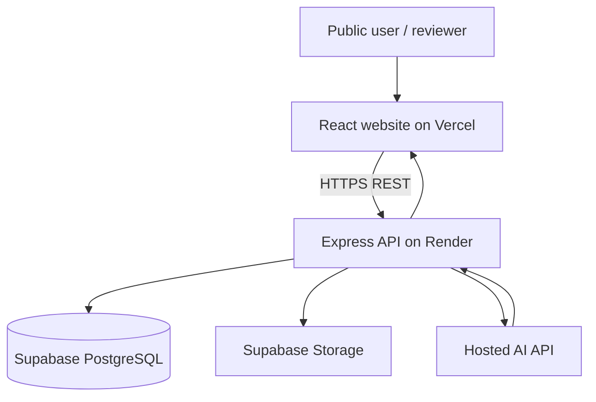

# CivicFix — Simple Deployment-First Architecture

## 1. Goal

CivicFix should be easy to deploy publicly so that a reviewer, mentor, judge, or friend can open a link and try the application. Avoid infrastructure that is difficult to configure or maintain for a student project demo.

There is no requirement to run the full system locally. Development can happen in the normal editor workflow, while the deployed services run in the cloud.

## 2. Final simple stack

| Part | Choice | Hosting |
|---|---|---|
| Frontend | React + TypeScript + Vite | Vercel |
| Backend | Node.js + Express | Render |
| Database | PostgreSQL | Supabase |
| Image storage | Supabase Storage | Supabase |
| AI | Hosted AI API | Provider-managed |
| Maps | Leaflet + selected map tile provider | Used by frontend |

Use one backend deployment. Do not create a separate Python/FastAPI service for the first public demo. Do not add Redis, BullMQ, Docker, Kubernetes, or a separate vector database.

## 3. Architecture diagram



The browser only talks to the Express API for privileged operations. The backend talks to Supabase and the AI provider using server-side credentials. Never put database service-role keys or AI API keys in frontend environment variables.

## 4. Responsibilities

### Frontend — `frontend/`
- Landing page using the Poster Modernist design system.
- Citizen registration/login and complaint submission.
- Complaint history, detail page, and status timeline.
- Admin dashboard, review queue, assignment and analytics views.
- Department staff view for assigned complaints and progress updates.
- Map and responsive layouts.
- Calls the backend using a single API client.

### Backend — `backend/`
- Authentication and role-based permissions.
- Complaint create/read/update workflows.
- Validation and lifecycle rules.
- Upload authorization and Supabase Storage integration.
- Database access through Supabase/PostgreSQL.
- AI request construction, API calls, response validation, and persistence.
- Admin review, human-approved assignment, status history, and notifications.
- Central error handling and request logging.

### AI module — inside `backend/src/modules/ai/`
Keep the six specification agents as small logical modules in the same backend:
1. Vision — inspect complaint images when the chosen hosted AI provider supports image input.
2. Location — validate coordinates and use a configured geocoding API if needed.
3. Classification and severity — suggest issue type and urgency.
4. Duplicate detection — compare against existing complaints using text/category/location heuristics for the first demo.
5. Department routing — recommend only from the verified departments stored in the database.
6. Follow-up — identify overdue complaints and suggest a reminder.

These are not six separately deployed agents or servers. They are simple backend modules coordinated by one AI workflow. Start with the provider's single API call where possible. If a capability is not supported by the chosen provider, show it as unavailable rather than pretending it ran.

### Database and storage — Supabase
- PostgreSQL stores users, complaints, departments, assignments, status history, AI analysis, and notifications.
- Supabase Storage stores uploaded images.
- Use standard relational queries first. Add PostGIS or pgvector only if the selected Supabase project plan and implementation genuinely need them; neither is required for the first demo.

## 5. Suggested repository structure

```text
civic_fix/
├── frontend/
│   ├── public/
│   └── src/
│       ├── components/
│       ├── pages/
│       ├── features/
│       │   ├── auth/
│       │   ├── complaints/
│       │   ├── admin/
│       │   └── department/
│       ├── services/       # backend API client
│       ├── styles/         # Poster Modernist tokens
│       ├── hooks/
│       └── types/
├── backend/
│   └── src/
│       ├── config/
│       ├── routes/
│       ├── controllers/
│       ├── middleware/
│       ├── modules/
│       │   ├── auth/
│       │   ├── complaints/
│       │   ├── departments/
│       │   ├── assignments/
│       │   ├── ai/         # six logical AI modules
│       │   └── notifications/
│       ├── services/       # Supabase and AI provider clients
│       └── utils/
├── docs/
├── .env.example
└── README.md
```

Do not create empty modules before they are needed. Add files as features are implemented.

## 6. Main request flow

1. A citizen opens the Vercel website and submits a complaint.
2. The frontend sends the complaint and image metadata to the Render API.
3. The backend validates the user and stores the complaint in Supabase.
4. The backend uploads/associates images in Supabase Storage.
5. The backend calls the configured hosted AI API and validates its response.
6. AI suggestions are saved as recommendations.
7. An administrator reviews the recommendations and makes the actual assignment.
8. The citizen sees the updated status and timeline.

For the first demo, AI processing can happen during the request with a sensible timeout. If it times out or the provider is not configured, the complaint must still be saved and marked “AI analysis pending/unavailable” so manual review remains possible.

## 7. Deployment plan

1. Create a Supabase project and configure database tables and Storage bucket.
2. Deploy the Express backend to Render and add environment variables.
3. Deploy the React frontend to Vercel and set the public backend URL.
4. Add the hosted AI provider key only to Render's secret environment variables.
5. Configure CORS to allow the deployed Vercel domain.
6. Test registration, complaint submission, image upload, admin review, and status updates using the public URL.

## 8. Security and demo reliability

- Keep all secrets in hosting environment settings, never in Git.
- Use a restricted Supabase key in the browser only if the browser directly uses Supabase Auth/Storage with correct row-level security; otherwise route access through the backend.
- Enforce roles and ownership in the backend.
- Never allow public registration to create an admin account.
- Limit image size and accepted formats.
- Validate all AI responses; treat them as suggestions, not trusted commands.
- Do not automatically reject complaints or assign departments based only on AI.
- Add a demo seed/admin setup path that does not expose default credentials publicly.
- Configure a health endpoint and a friendly frontend error state if the backend sleeps or is unavailable.

## 9. Deferred until needed

The following are intentionally excluded from the first deployable demo:
- Separate FastAPI service and LangGraph server.
- Redis and BullMQ.
- Docker and Docker Compose.
- Self-hosted Qwen model inference.
- Dedicated vector database and advanced geospatial extensions.
- Kubernetes, message brokers, and microservice infrastructure.

They can be introduced later if real scale or evaluation results justify them.
