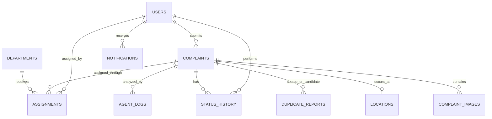

# CivicFix — Database Design

## 1. Database strategy

Use PostgreSQL as the primary relational database with:
- **PostGIS** for geographic points, distance queries, and spatial indexes.
- **pgvector** for semantic complaint embeddings and nearest-neighbor search.
- JSONB only for flexible, versioned AI payloads and structured metadata; core business entities remain normalized.

Use SQL migrations as the source of schema truth. Prefer explicit SQL for PostGIS and pgvector features.

## 2. Core entities and relationships

## 3. Tables

### users
- `id` UUID primary key.
- `full_name`, `email` (unique, normalized), `phone` (optional).
- `password_hash`; never store plaintext passwords.
- `role`: CITIZEN, ADMIN, DEPARTMENT_STAFF.
- `department_id` nullable FK for department staff.
- `is_active`, `created_at`, `updated_at`.
- Index email and (role, is_active).

### complaints
- `id` UUID primary key; `public_id` unique human-readable reference.
- `citizen_id` FK users.
- `title`, `description`.
- `category`: configurable controlled vocabulary; allow UNCLASSIFIED before AI/human review.
- `severity`: LOW, MEDIUM, HIGH, CRITICAL, nullable before analysis.
- `status`: REPORTED, AI_ANALYSIS, UNDER_REVIEW, ASSIGNED, IN_PROGRESS, RESOLVED, REOPENED, REJECTED.
- `rejection_reason` nullable; required when status is REJECTED.
- `created_at`, `updated_at`, `resolved_at` nullable.
- Index (citizen_id, created_at), (status, created_at), (category, severity).

### complaint_images
- `id` UUID primary key; `complaint_id` FK.
- `storage_provider`, `object_key`, `secure_url` or delivery reference.
- `mime_type`, `size_bytes`, `checksum`, `width`, `height` optional.
- `uploaded_by` FK users, `created_at`.
- Index complaint_id. Restrict accepted MIME types and size in application and storage policy.

### locations
- `id` UUID primary key; `complaint_id` unique FK.
- `point` geography(Point, 4326) or geometry(Point, 4326), selected consistently.
- `address_text`, `locality`, `landmark`, `source` (GPS/manual/geocoded).
- `location_precision`, `created_at`.
- GiST index on spatial point. Store only the precision required for civic resolution.

### departments
- `id` UUID primary key.
- `name` unique, `description`, `service_categories` controlled data.
- `locality_scope`/jurisdiction metadata as required.
- `is_active`, `created_at`, `updated_at`.
- Directory entries must be verified by administrators. No AI-created departments or contact details.

### assignments
- `id` UUID primary key; `complaint_id` FK; `department_id` FK.
- `assigned_to` nullable FK users; `assigned_by` FK users.
- `recommendation_id` nullable reference to AI analysis; `decision_note`.
- `assigned_at`, `due_at`, `completed_at` nullable.
- Index (department_id, assigned_at), (complaint_id, assigned_at).
- Assignment creation requires authorized human approval.

### status_history
- `id` UUID primary key; `complaint_id` FK; `actor_user_id` FK users nullable only for explicitly identified system events.
- `from_status`, `to_status`, `reason`, `created_at`.
- Index (complaint_id, created_at). Append-only to preserve audit history.

### duplicate_reports
- `id` UUID primary key.
- `complaint_id` FK; `possible_duplicate_id` FK complaints.
- `semantic_score`, `distance_meters`, `category_match`, `combined_score`.
- `model_name`, `model_version`, `review_status`, `created_at`.
- Unique pair constraint using canonical complaint ID ordering; prevent self-pairs.
- Index complaint_id and possible_duplicate_id.

### agent_logs
- `id` UUID primary key; `complaint_id` FK nullable for non-complaint workflows.
- `workflow_run_id`, `agent_name`, `status`, `input_summary`, `output_json` JSONB.
- `model_name`, `model_version`, `duration_ms`, `error_code`, `created_at`.
- Index (complaint_id, created_at), (workflow_run_id), (agent_name, status).
- Avoid logging raw image bytes, credentials, or unnecessary personal information.

### notifications
- `id` UUID primary key; `user_id` FK users; `complaint_id` nullable FK.
- `channel`, `type`, `title`, `body`, `read_at`.
- `delivery_status`, `provider_message_id`, `created_at`, `sent_at`.
- Index (user_id, read_at, created_at).

## 4. Additional supporting tables recommended

### complaint_embeddings
- `id` UUID primary key; `complaint_id` FK; `embedding` vector(dimension determined by selected BGE-M3 output configuration).
- `model_name`, `model_version`, `content_hash`, `created_at`.
- Index using a pgvector-supported ANN method selected after measuring dataset size and query quality.
- Keep embedding model/dimension consistent within an index; re-embed when model changes.

### ai_analyses
- `id` UUID primary key; `complaint_id` FK; `analysis_version`, `workflow_run_id`.
- `category_recommendation`, `severity_recommendation`, `department_recommendation_id` nullable FK.
- `vision_result`, `location_result`, `classification_result`, `duplicate_result`, `routing_result` JSONB.
- `overall_status`, `created_at`, `completed_at`.
- Unique (complaint_id, analysis_version). Separates machine recommendations from human-approved complaint fields.

### notification_outbox
- Transactional outbox row created in the same transaction as status/notification changes.
- `id`, `notification_id`, `event_type`, `payload` JSONB, `attempts`, `available_at`, `processed_at`, `last_error`.
- Prevents lost notification events between database commit and queue publication.

## 5. Relationships and authorization rules

- Citizens can read their own complaints and public/sanitized nearby complaint summaries.
- Administrators can review all complaints and manage verified departments.
- Department staff can read only complaints assigned to their department and update permitted workflow fields.
- Assignment and rejection require administrator or explicitly authorized role.
- Every status change records actor, timestamp, and reason where required.
- Do not expose other citizens' contact details or precise private location data in nearby-complaint views.

## 6. Indexing strategy

- B-tree: unique email/public_id, complaint status/date, citizen/date, department/date.
- GiST: PostGIS point column for radius and bounding-box searches.
- pgvector ANN index: choose HNSW or IVFFlat only after verifying extension version, embedding dimension, data volume, and recall/latency trade-offs.
- JSONB indexes only for fields queried repeatedly; avoid blanket indexing.
- Use EXPLAIN ANALYZE with realistic data before performance tuning.

## 7. Data integrity

- Use UUID primary keys and foreign keys.
- Use CHECK constraints for enum-like values if PostgreSQL enums are not chosen.
- Add a constraint requiring rejection_reason for REJECTED status.
- Use transactions for complaint creation, status changes, assignment creation, and outbox writes.
- Preserve status history; do not overwrite audit records.
- Define retention and deletion policy for images, precise locations, logs, and user data before production.
