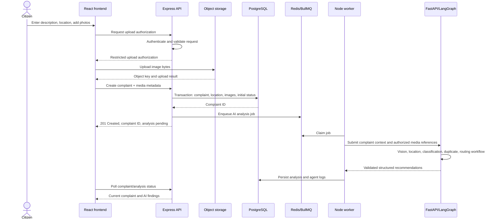
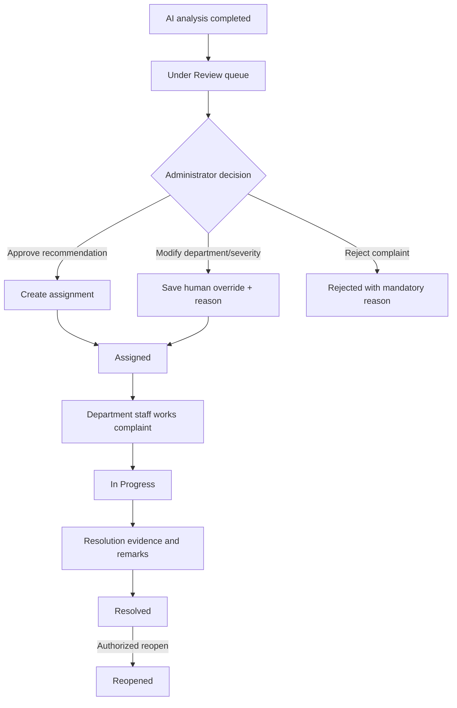

# CivicFix — Service Communication and Data Flows

## 1. System boundaries

The browser communicates only with the Node/Express public API over HTTPS. The backend owns authentication, authorization, persistence, complaint state, job scheduling, and notifications. The Python AI service is a private inference/orchestration service. PostgreSQL is the source of truth.

## 2. Complaint submission flow

If direct browser-to-storage upload is not used in the first iteration, the API may proxy uploads. In either case, enforce file limits and store only metadata in PostgreSQL.

## 3. AI workflow

1. Backend creates the complaint and commits it before queuing work.
2. BullMQ receives an idempotent job keyed by complaint ID and analysis version.
3. Worker loads the minimum authorized complaint context and sends it to the private FastAPI endpoint.
4. Vision Agent checks image relevance and describes visible evidence. If no image exists, the workflow records that vision was skipped rather than fabricating a result.
5. Location Agent validates coordinates and optionally reverse-geocodes them. Missing location is an explicit incomplete field, not an invented address.
6. Classification Agent combines citizen text and vision findings; returns category, severity, and rationale in a schema.
7. Duplicate Agent evaluates a bounded candidate set using embedding similarity, category agreement, and geographic proximity. It flags candidates; it does not merge or reject.
8. Department Routing Agent selects only from the verified directory supplied by the backend. If no verified match exists, it returns “no recommendation”.
9. AI service returns structured findings and per-agent outcomes.
10. Backend validates and persists the result. Complaint becomes ready for human review.
11. Administrator reviews, edits, approves, or rejects recommendations. Assignment is created only after authorized approval.

Failures are isolated: each agent records success, skipped, or failed state. Retry transient failures only. A permanent model or provider failure must leave the complaint available for manual review.

## 4. Human review and assignment

Every decision and state transition is auditable. The system must distinguish AI recommendation from human-approved assignment in storage and UI.

## 5. Status tracking and notifications

- A domain service validates whether a requested transition is allowed for the actor's role.
- A database transaction updates current complaint status and inserts a status-history row.
- The same transaction creates an internal notification/outbox record.
- A background worker sends external notifications if a provider is configured.
- Delivery failures retry independently and never roll back the complaint status.
- Citizen sees the timeline and notification state through authorized API reads.

## 6. Duplicate detection data flow

- Backend fetches candidate complaints in a geographic radius using PostGIS and filters by relevant categories/status.
- Embeddings are generated for new and existing descriptions using the configured BGE-M3 embedding model.
- pgvector similarity ranks semantic candidates.
- AI/service logic combines semantic score, distance, and category compatibility.
- Results are stored as possible duplicate pairs with score and rationale.
- Citizens/admins may inspect similar reports. No complaint is automatically rejected or merged.

## 7. Follow-up and escalation flow

- A scheduled backend job finds complaints whose status age exceeds configurable service targets.
- The follow-up agent can summarize overdue context and recommend a reminder/escalation.
- Backend creates a notification or an administrator review item.
- Only an authorized human action changes assignment or complaint status.
- Time thresholds are configuration, not hardcoded model decisions.

## 8. Data ownership and trust

| Data | System of record | Notes |
|---|---|---|
| Users and roles | PostgreSQL | Password hashes only |
| Complaint and lifecycle | PostgreSQL | Backend-authoritative |
| Image binary | Object storage | Database stores metadata and object key |
| Location geometry | PostgreSQL/PostGIS | Apply precision/retention policy |
| Embeddings | PostgreSQL/pgvector | Version model metadata |
| AI outputs and agent logs | PostgreSQL | Mark as machine-generated |
| Jobs and retry state | Redis/BullMQ | Durable business outcome remains in PostgreSQL |
| Notifications | PostgreSQL + provider | Delivery status tracked separately |

## 9. Idempotency and failure handling

- Use a unique analysis job key per complaint and analysis revision.
- Worker must safely handle duplicate job delivery.
- Persist job state and analysis version so retries do not overwrite newer human decisions.
- Set timeouts for model inference and geocoding.
- Use bounded retry counts and exponential backoff for transient failures.
- Validate all AI response schemas; malformed output becomes a controlled analysis failure.
- Do not enqueue AI work until complaint/media metadata is committed.
- If AI is unavailable, citizens can still submit and track complaints; administrators can review manually.
