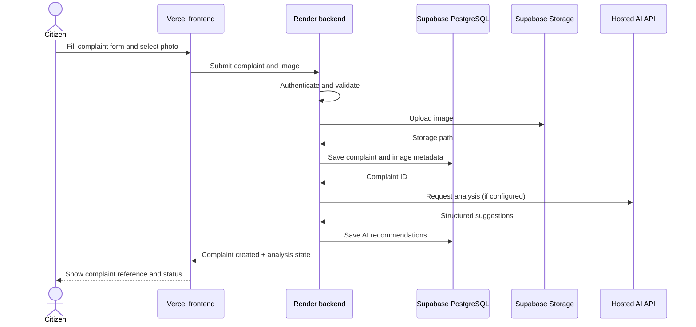

# CivicFix — Simple Data Flow

## 1. Services

- React frontend: deployed on Vercel.
- Express backend: deployed on Render.
- Supabase: hosted PostgreSQL and image storage.
- Hosted AI provider: called by the backend using a server-side API key.

The browser does not connect to the AI provider directly and does not receive privileged database credentials.

## 2. Complaint submission

If AI fails, the complaint remains saved. The API returns an AI status such as pending or unavailable; users can still view and administrators can manually review it.

## 3. AI workflow

The six agents are logical modules within the backend, not separate cloud services:
1. Vision: inspect the uploaded photo if image input is supported by the selected AI provider.
2. Location: validate provided coordinates; optionally call a geocoding provider.
3. Classification/severity: suggest category, severity, and a short explanation.
4. Duplicate detection: compare complaint text, category, and approximate location against recent reports.
5. Department routing: recommend from the verified department list only.
6. Follow-up: flag overdue cases and suggest reminders.

For the first demonstration, these can be orchestrated in one backend service using one or a small number of hosted AI requests. Store which checks actually ran. Never label a skipped capability as completed.

## 4. Human review

1. AI recommendations appear in the administrator review queue.
2. Administrator may accept, edit, or reject the recommendation.
3. Only an authorized human creates the department assignment or rejects a complaint.
4. Backend writes the decision and status-history entry to PostgreSQL.
5. Citizen sees the new status on the complaint page.

## 5. Status and notification flow

- Backend validates the role and allowed status transition.
- Backend updates the complaint and inserts a status-history row in Supabase.
- The frontend fetches the latest timeline.
- In-app notifications can be stored in the database.
- Email/SMS can be added later if a provider is configured; they are not required for the first public demo.

## 6. Duplicate reports

For the first demo, use a simple comparison based on category, text similarity, and approximate location. Display possible matches as suggestions to the administrator. Do not automatically merge or reject reports. pgvector and advanced spatial indexing are deferred until there is enough data to justify them.

## 7. Security boundaries

- Frontend: public UI and user interactions only.
- Backend: authentication, authorization, validation, AI API key, database operations.
- Supabase: persistent data and private image storage.
- AI provider: receives only the complaint content required for analysis.

Do not send passwords, access tokens, or unnecessary personal details to the AI provider. Configure storage access policies and CORS for the deployed domains.
